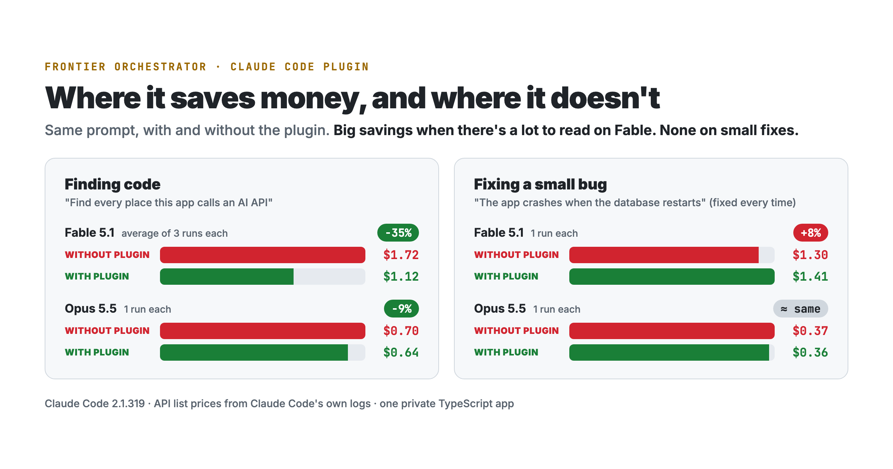

<div align="center">

# Awal's Claude Code Skills

Plugins and skills I use every day in Claude Code, shared with proof of what they do.




</div>

## Install

Paste one line into your terminal for the skill you want (Claude Code 2.1.292 or later):

```bash
claude plugin install frontier-orchestrator --marketplace awalhossainofficial/claude-code-skills
```

Then start a new Claude Code session. It's on for you in every project from then on, with nothing to turn on.

Prefer doing it inside Claude Code? Paste `/plugin marketplace add awalhossainofficial/claude-code-skills` into the chat box, then the install line from the table below, and pick **Install for you (user scope)**.

## Skills

| Skill | What it does | Install |
| :- | :- | :- |
| [**Frontier Orchestrator**](plugins/frontier-orchestrator) | Fable or Opus leads, and cheaper Sonnet helpers do the searching, reading and routine edits. About 35% cheaper on Fable for reading-heavy work in testing. | `/plugin install frontier-orchestrator@awal-skills` |

More coming soon.

## License

MIT. Each skill's own folder has its README, its proof, and how it was measured.
