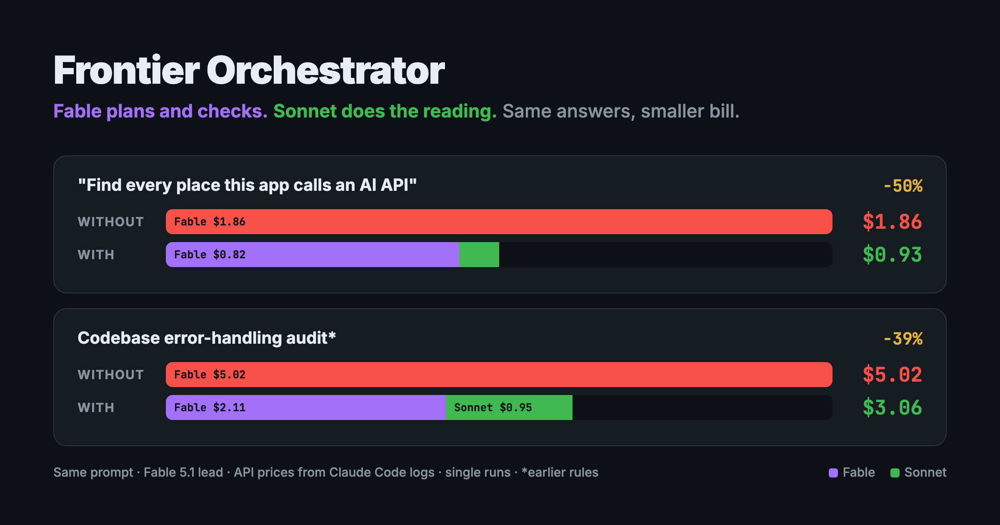

<div align="center">

# Frontier Orchestrator

**Your expensive model leads. Cheaper Sonnet helpers do the reading.**<br>
Same answers from Claude Code, for about half the bill.




</div>

## Install

In Claude Code, run:

```
/plugin marketplace add awalhossainofficial/claude-code-skills
/plugin install frontier-orchestrator@awal-skills
```

Then start a new session. That's it: no commands to remember. The plugin works on its own in every project.

**Check it's working:** ask something that needs a search, such as *"where does this app handle logins?"*. You'll see Claude start `frontier-orchestrator:scout` with **Sonnet 5.5** next to it, instead of reading the files itself.

## What it does

Out of the box, Fable in Claude Code rarely hands work off on its own. When it does, the helper usually runs on an expensive model. Most of a coding session is reading code, and that reading gets billed at frontier prices.

This plugin changes the default:

- **Startup rules,** loaded into every session, tell Fable or Opus to send searching, reading, test runs and routine edits to helpers first. They switch themselves off when the main model is Sonnet or Haiku.
- **Four helpers with their model fixed,** so they can't fall back to an expensive one:
  - `scout`: Sonnet, read-only. Searching and reading. The default helper.
  - `builder`: Sonnet. Edits from a clear plan.
  - `checker`: Sonnet. Runs tests, lint and builds; never edits.
  - `deep-reviewer`: Opus, read-only. Only for security, concurrency, data integrity and migrations.
- **An `orchestrate` skill** with the full plan → discover → decide → build → verify → report playbook. It loads by itself for big multi-step jobs.

The expensive model still plans, makes the decisions and reviews every result. It just stops paying top price to read files.

## Proof

Each test ran the same prompt on the same private TypeScript app, with Fable 5.1 as the main model. The prompts never mentioned helpers. The costs are what Claude Code itself reports, at Claude API list prices.

- **"Find every place this app calls an AI API"**
  - Without the plugin: **$1.86**. Fable did all the reading itself.
  - With the plugin: **$0.93**. Fable sent one Sonnet scout on its own.
  - Both answers named 16 of the same files, and the plugin run found 3 more.
- **Codebase error-handling audit** (earlier version of the rules)
  - Without: **$5.02** in 4 min 34 s.
  - With: **$3.06** in 51 s, with comparable findings.
- **An honest miss.** The plugin's first draft used softer wording, and Fable ignored it: $1.95, no helpers. That's why the current rules start with one firm rule: send a scout first.

The raw cost figures for every run are in [`proof/runs.json`](../../proof/runs.json).

**How measured:** each run was a fresh `claude -p` session on Claude Code 2.1.319. The other rules on the machine were switched off, so only the plugin differed. These are single runs, so treat the numbers as examples, not guarantees.

## Optional: lock every helper onto Sonnet

A plugin can't change your settings, so these two steps are manual. They make helpers use Sonnet even when the model forgets to pick one.

1. Add this to `~/.claude/settings.json`. It needs Claude Code 2.1.251 or later; on older versions it also overrides deliberate Opus choices.
   ```json
   "env": { "CLAUDE_CODE_SUBAGENT_MODEL": "sonnet" }
   ```
2. Copy [`extras/Explore.md`](extras/Explore.md) into `~/.claude/agents/`. It replaces Claude Code's built-in search helper, which runs on Opus under Fable, with a Sonnet one. [Anthropic's docs](https://code.claude.com/docs/en/sub-agents) suggest doing exactly this.

## Good to know

- **Savings depend on the work.** Reading-heavy jobs save the most. For a tiny one-file fix, the rules tell the model to skip helpers.
- **Cheaper in dollars, not always in tokens.** A run with helpers can use more tokens in total, because most of them are Sonnet tokens at about a fifth of the price.
- **Other providers differ.** On Amazon Bedrock, Google Cloud or Microsoft Foundry, Claude Code's defaults differ, and so will your savings.
- **Company settings win.** Organization-managed settings and model allowlists override this plugin.
- **Tested so far on one machine** with Fable 5.1. Results from Opus or other setups are welcome as issues.

## How it works

- `hooks/hooks.json` runs `cat rules.md` when a session starts. Claude Code adds that text to the model's context.
- `agents/*.md` define the helpers. The `model:` line in each one is what Claude Code uses when the lead doesn't name a model.
- `skills/orchestrate/SKILL.md` is the long playbook for big jobs.

## Uninstall

```
/plugin uninstall frontier-orchestrator@awal-skills
```

If you did the optional steps, also remove the `env` line and `~/.claude/agents/Explore.md`.
